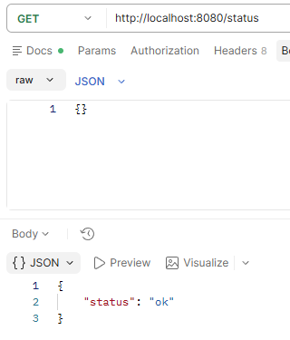
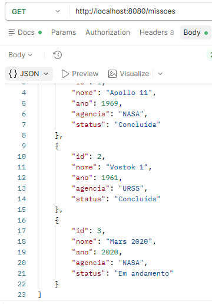
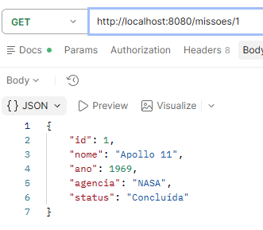
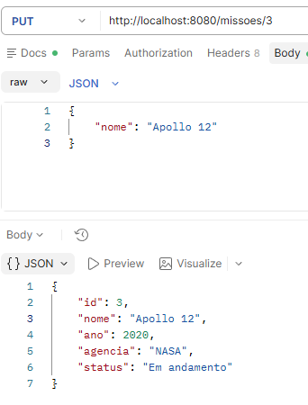
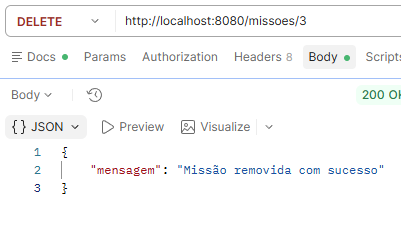

# API de Missões Espaciais

## 1. Identificação

- **Aluna:** Luiza Vittória Cardoso
- **Curso:** Informática
- **Unidade Curricular:** Desenvolver Serviços Web


## 2. Descrição do projeto

API REST para consulta e gerenciamento de missões espaciais. A API disponibiliza uma rota de status, listagem de missões com filtro pelo nome, consulta por ID e operações de criação, atualização e remoção. Os dados iniciais incluem Apollo 11, Vostok 1 e Mars 2020.

## 3. Tecnologias utilizadas

- PHP
- Slim Framework 4
- Composer
- JSON
- PSR-7 (Slim PSR-7)

## 4. Como clonar o projeto

Substitua `URL_DO_REPOSITORIO` pelo endereço do repositório:

```bash
git clone URL_DO_REPOSITORIO
cd nasa
```

## 5. Como instalar as dependências

Na raiz do projeto, execute:

```bash
composer install
```

É necessário ter PHP e Composer instalados.

## 6. Como executar o projeto

Na raiz do projeto, inicie o servidor embutido do PHP:

```bash
php -S localhost:8080 -t public public/index.php
```

A API ficará disponível em `http://localhost:8080`. Para interromper o servidor, pressione `Ctrl+C` no terminal.

## 7. Documentação dos endpoints

Todos os exemplos abaixo usam `http://localhost:8080` como endereço-base. As respostas são JSON e incluem o cabeçalho `Content-Type: application/json`. Para requisições `POST` e `PUT`, envie o corpo como JSON com o cabeçalho `Content-Type: application/json`.

### Verificar status da API

- **Método:** `GET`
- **URL:** `/status`
- **Objetivo:** confirmar que a API está respondendo.
- **Requisição:** `GET http://localhost:8080/status`
- **Resposta — 200 OK:**
- **Print:**
```json
{
	"status": "ok"
}
```

### Listar missões

- **Método:** `GET`
- **URL:** `/missoes`
- **Objetivo:** retornar todas as missões. Opcionalmente, filtra pelo nome usando o parâmetro `nome` (busca parcial, sem diferenciar maiúsculas de minúsculas).
- **Requisição:** `GET http://localhost:8080/missoes`
- **Resposta — 200 OK:**
- **Print:**
```json
[
	{
		"id": 1,
		"nome": "Apollo 11",
		"ano": 1969,
		"agencia": "NASA",
		"status": "Concluída"
	},
	{
		"id": 2,
		"nome": "Vostok 1",
		"ano": 1961,
		"agencia": "URSS",
		"status": "Concluída"
	},
	{
		"id": 3,
		"nome": "Mars 2020",
		"ano": 2020,
		"agencia": "NASA",
		"status": "Em andamento"
	}
]
```

Exemplo de filtro: `GET http://localhost:8080/missoes?nome=mars`.

### Consultar missão por ID

- **Método:** `GET`
- **URL:** `/missoes/{id}`
- **Objetivo:** retornar uma missão específica.
- **Requisição:** `GET http://localhost:8080/missoes/1`
- **Resposta — 200 OK:**
- **Print:** 
```json
{
	"id": 1,
	"nome": "Apollo 11",
	"ano": 1969,
	"agencia": "NASA",
	"status": "Concluída"
}
```

Se o ID não existir, a API retorna **404 Not Found**:

```json
{
	"erro": "Missão não encontrada"
}
```
- **Print:** 
### Criar missão

- **Método:** `POST`
- **URL:** `/missoes`
- **Objetivo:** Criar uma missão informando seu nome.
- **Requisição:** `POST http://localhost:8080/missoes`
- **Corpo JSON:**
- **Print:** 

```json
{
	"nome": "Artemis I"
}
```

- **Resposta — 201 Created:**

```json
{
	"id": 4,
	"nome": "Artemis I"
}
```

### Atualizar missão

- **Método:** `PUT`
- **URL:** `/missoes/{id}`
- **Objetivo:** Alterar o nome da missão indicada pelo ID.
- **Requisição:** `PUT http://localhost:8080/missoes/1`
- **Corpo JSON:**
- **Print:** 

```json
{
	"nome": "Apollo 11 - atualizada"
}
```

- **Resposta — 200 OK:**

```json
{
	"id": 1,
	"nome": "Apollo 11 - atualizada",
	"ano": 1969,
	"agencia": "NASA",
	"status": "Concluída"
}
```

Para um ID inexistente, retorna **404 Not Found** com `{"erro":"Missão não encontrada"}`.

### Remover missão

- **Método:** `DELETE`
- **URL:** `/missoes/{id}`
- **Objetivo:** Remover a missão indicada pelo ID.
- **Requisição:** `DELETE http://localhost:8080/missoes/1`
- **Resposta — 200 OK:**
- **Print:** 
```json
{
	"mensagem": "Missão removida com sucesso"
}
```

Para um ID inexistente, retorna **404 Not Found** com `{"erro":"Missão não encontrada"}`.